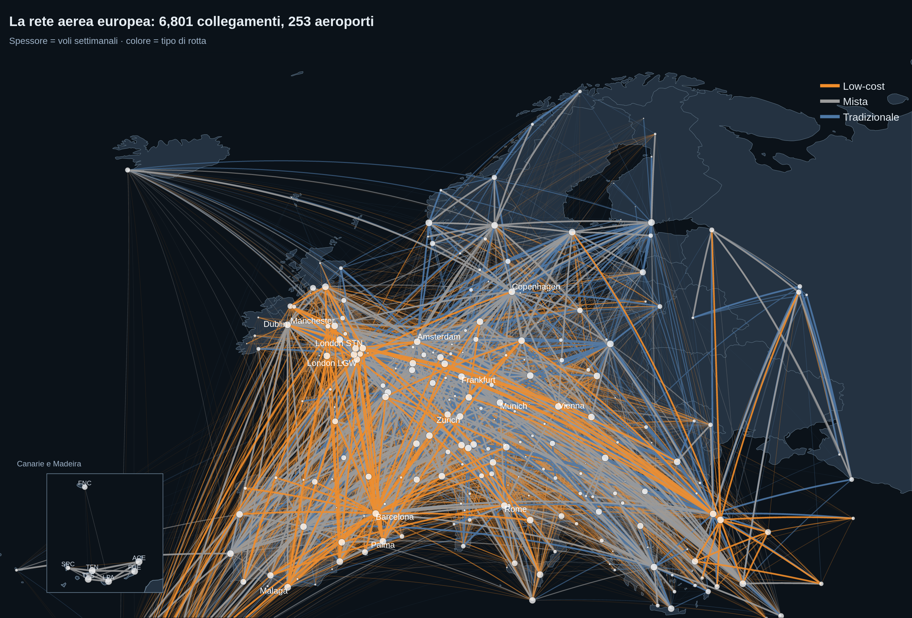
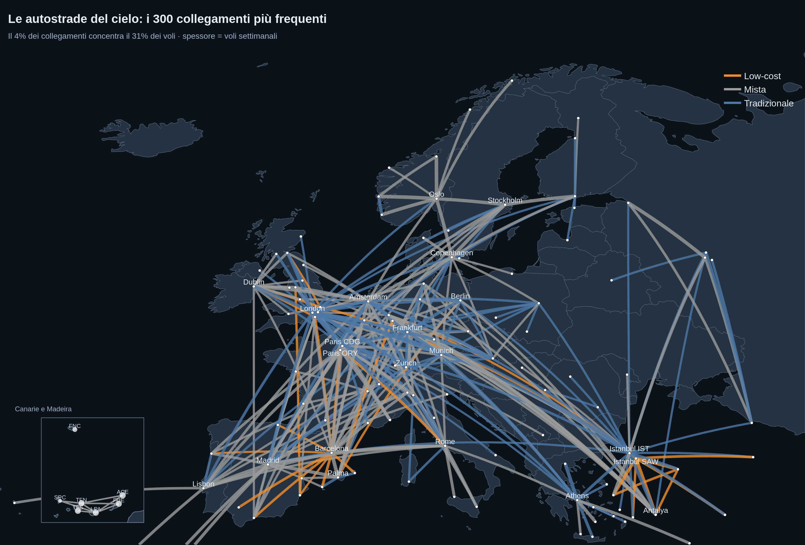

# La connettività dei cieli: traffico aereo e low-cost in Europa

Progetto per il corso **Principi e modelli della percezione** (Informatica per la Comunicazione Digitale).





## Obiettivo

Analizzare la connettività aerea e il peso delle compagnie low-cost in Europa: quali aeroporti fanno da hub, come sono distribuite le rotte low-cost rispetto a quelle tradizionali e come cresce la rete regionale rispetto ai grandi scali storici. L'algoritmo scelto per il corso è il **clustering** (K-means, con mean-shift come confronto), usato per far emergere dai dati la distinzione tra due modelli di hub.

## Risultati principali

- **253 aeroporti**, 42 paesi, **13.499 rotte dirette** (6.801 collegamenti non orientati), circa **128.000 voli a settimana**.
- Il **77% delle rotte** ha almeno una compagnia low-cost; **Ryanair** (con le sue sub-brand) opera oltre 4.400 rotte.
- Risultato controintuitivo: il **4% dei collegamenti (300) concentra il 31% dei voli**, ma solo 26 di questi 300 sono puramente low-cost. Le low-cost dominano per capillarità, le dorsali più frequenti sono miste o tradizionali.
- Esistono due modelli di hub: scali storici di compagnie tradizionali (Francoforte, Heathrow, Monaco, Zurigo) e grandi basi low-cost (Londra Stansted, Barcellona, Manchester).
- Il **clustering K-means (k=5)** formalizza questa distinzione: 11 hub tradizionali (26% di collegamenti con low-cost) contro 50 grandi scali a prevalenza low-cost (86%), a parità di dimensione; Amsterdam e Varsavia sono casi di confine. La separazione è plausibile ma fragile (silhouette 0,37): mean-shift trova da 2 a 18 gruppi a seconda della larghezza di banda.
- **Variabili importanti.** Destinazioni e voli settimanali sono molto correlati (r = 0,88) e dominano la partizione complessiva; la quota low-cost è però indispensabile per separare gli hub tradizionali dai grandi scali low-cost, che senza di essa finiscono mescolati.
- **Normalizzazione.** Senza standardizzare, le destinazioni pesano il 99,9% della varianza e K-means raggruppa di fatto solo per dimensione (silhouette 0,14 contro 0,37; ARI 0,39 tra le due partizioni): la standardizzazione è necessaria.
- Il **55%** dei collegamenti è tra aeroporti regionali e solo il 4% tra due grandi hub; la quota regionale–regionale sale al 56–65% tra le rotte aperte dal 2022 in poi (2025 parziale).
- Prezzo mediano indicativo: ~50 € low-cost contro ~130 € tradizionali.

## Struttura del repository

```
.
├── analisi_traffico_aereo_europa.ipynb   # notebook completo, già eseguito e commentato
├── data/
│   ├── europe_air_routes.csv             # dataset di partenza (rotte aeree europee, programmazione raccolta ad agosto 2025)
│   └── eurostat_validazione_rotte.csv    # voli e passeggeri ufficiali Eurostat per le rotte in comune (serve alla validazione)
├── scripts/
│   └── validazione_eurostat.py           # costruisce il file di validazione dalle tabelle Eurostat avia_par_* (non incluse: ~800 MB)
├── images/                               # grafici in PNG (usati anche nelle slide)
├── outputs/                              # versioni interattive (HTML) dei grafici + summary.json
├── presentazione_traffico_aereo_europa.pptx
├── requirements.txt
├── .gitignore
└── README.md
```

## Il dataset

`data/europe_air_routes.csv`: una riga per ogni rotta diretta (18.111 righe, 33 colonne) con frequenza settimanale, data del primo volo, prezzo, coordinate degli aeroporti e compagnie che operano la rotta. Dopo il filtro sull'Europa restano 13.499 rotte. La tabella di tutte le variabili con tipo e valori mancanti è nel notebook (par. 2.1).

### Provenienza e affidabilità

- **Fonte:** dataset Kaggle *European Airports & Air Routes* di V. Laputsky. Le rotte sono state raccolte con web scraping del sito FlightsFrom per circa 260 grandi aeroporti europei; le coordinate vengono da OpenFlights. Non è una fonte ufficiale (Eurostat, Eurocontrol) e non è validata.
- **Cosa descrive una riga:** una rotta con la sua programmazione (frequenza settimanale, giorni, primo e ultimo volo), non un singolo volo e non i passeggeri.
- **Data:** estrazione dichiarata l'**11/8/2025**; è coerente con i dati (nessuna rotta ha `last_flight` precedente a metà settembre 2025). Il file arriva fino a ottobre 2026 (stagione estiva 2026) e in parte aprile 2027 perché include la programmazione futura e rotte annunciate. **Non è un'istantanea 2026.**
- **Controlli (par. 3.1 del notebook):** 753 righe (261 collegamenti) hanno primo volo dopo l'estrazione e sono escluse dalle analisi per anno; frequenza 0 in 488 righe, prezzo 0 nell'11%; il 99% delle rotte europee ha il ritorno nel file; ordini di grandezza plausibili per i grandi scali (es. Francoforte).
- **Validazione con dati ufficiali (par. 3.2 del notebook):** abbiamo confrontato le frequenze con i voli 2024 delle tabelle Eurostat `avia_par_*` (8.527 rotte europee in comune, il 63% delle rotte e l'87% dei voli). Correlazione di Spearman **0,98 per aeroporto** e **0,90 per rotta**, mediana del rapporto 1,04, voli totali entro il 5%. La singola rotta è approssimata (57% entro ±30%) perché si confrontano agosto 2025 e il 2024. Caso anomalo: Istanbul (+65%), causa non verificata. Eurostat non contiene le compagnie: la quota low-cost resta affidata alla nostra classificazione. Gli ultimi dati Eurostat sono del 2024 e il Regno Unito non è paese dichiarante dopo il 2019.
- **Dimensione:** 18.111 righe bastano per descrivere la rete; per il clustering l'unità è l'aeroporto (253 campioni, 3 variabili), pochi per gruppi stabili.

## Metodo

1. **Filtro Europa**: solo rotte con entrambi gli estremi in aeroporti europei.
2. **Classificazione low-cost**: il flag del dataset è incoerente, quindi si usa il flag *oppure* un elenco di vettori low-cost noti. Ogni rotta è *Low-cost*, *Tradizionale* o *Mista*.
3. **Wrangling con Pandas**: collegamenti non orientati, metriche per aeroporto (destinazioni, voli, quota low-cost), matrice origine-destinazione tra paesi, coorti per anno di primo volo.
4. **Clustering degli aeroporti** (scikit-learn):
   - variabili: destinazioni, voli settimanali (in scala logaritmica) e quota di collegamenti con almeno una low-cost, **standardizzate**;
   - **K-means** come algoritmo principale, con k scelto guardando gomito e silhouette;
   - **mean-shift** come confronto di robustezza (Adjusted Rand Index tra le due partizioni);
   - **analisi delle variabili**: centroidi, varianza spiegata (η²) e ablazione (K-means rifatto togliendo una variabile alla volta);
   - **valutazione della normalizzazione**: K-means con e senza standardizzazione.
5. **Clustering e percezione.** Davanti a uno scatter l'occhio raggruppa i punti per vicinanza e somiglianza (principi della Gestalt). K-means formalizza il raggruppamento per somiglianza (la distanza tra aeroporti, il centroide come prototipo del gruppo), mean-shift i picchi di densità (la larghezza di banda come scala a cui si guarda). È un'analogia: serve a discutere cosa il modello cattura del raggruppamento percettivo e cosa no (confini netti contro un continuum).
6. **Visualizzazione con Plotly**: mappe interattive, grafici a barre, scatter, heatmap.

Le compagnie dello stesso gruppo (es. Wizz Air + Wizz Air Malta, Ryanair + Ryanair UK/Malta Air) sono unite nella classifica per non contarle due volte.

## Come eseguirlo

Servono Python 3.10 o superiore e Jupyter. Dalla cartella del progetto:

```bash
pip install -r requirements.txt
jupyter notebook analisi_traffico_aereo_europa.ipynb
```

Il notebook gira con i file già presenti in `data/`. Lo script `scripts/validazione_eurostat.py` serve solo per rigenerare `data/eurostat_validazione_rotte.csv` partendo dalle tabelle Eurostat originali (`python scripts/validazione_eurostat.py CARTELLA_TSV`).

Poi, nel notebook, menu **Kernel → Restart & Run All** (in JupyterLab: *Run → Run All Cells*). Il file `data/europe_air_routes.csv` deve stare nella cartella `data/` accanto al notebook.

Il notebook salva i grafici in `images/` (PNG) e `outputs/` (HTML interattivo, da aprire nel browser). Le mappe interattive sono in [`outputs/01_mappa_rete.html`](outputs/01_mappa_rete.html) e [`outputs/02_low_cost_vs_tradizionale.html`](outputs/02_low_cost_vs_tradizionale.html).

Se il salvataggio dei PNG dà errore, il pacchetto `kaleido` (versione 1 o successiva) richiede Chrome o Chromium installato sul computer: segui le indicazioni del messaggio d'errore.

## Limiti

- Il clustering è sensibile al numero di cluster e all'algoritmo: la silhouette è massima per k=2–3 e k=5 è scelto perché è il primo che separa i due tipi di hub; mean-shift trova da 2 a 18 gruppi a seconda della larghezza di banda, e i confini tra i gruppi sono sfumati. Anche K-means ha una stabilità moderata tra inizializzazioni diverse (ARI medio 0,71).
- La quota low-cost è sia una variabile in ingresso al clustering sia ciò che definisce i due modelli di hub: il risultato formalizza una distinzione già vista a occhio, non la conferma in modo indipendente.
- Destinazioni e voli settimanali sono molto correlati (r = 0,88): la dimensione conta di fatto due volte. I nomi dei cluster sono assegnati con soglie fissate a mano.
- Il dataset è una fotografia della programmazione di agosto 2025, non una serie storica: l'evoluzione è ricostruita dalla data del primo volo e vede solo le rotte sopravvissute (2025 parziale). Il picco 2018 è un artefatto della raccolta dati.
- Copertura limitata a ~260 grandi aeroporti: i "regionali" sono scali medio-grandi.
- Il clustering è sensibile ai dati: correggere la classificazione di 36 collegamenti (KM Malta Airlines, prima scambiata per low-cost) ha spostato Amsterdam e Varsavia di cluster.
- Non ci sono dati sui passeggeri: il "volume" è approssimato con i voli settimanali.
- Il campo `price` è solo un "estimated price" non documentato (11% di zeri) ed è usato solo come indicazione.

## Dati

Fonte validazione: Eurostat, tabelle `avia_par_*` (*Air passenger transport routes between partner airports and main airports*), dati fino al 2024; scaricate dal Data Browser come TSV per ogni paese.

Fonte dataset: [European Airports & Air Routes](https://www.kaggle.com/datasets/lunthu/european-airlines-routes) - Victor Laputsky (Kaggle); rotte raccolte da FlightsFrom, coordinate da OpenFlights, estrazione 11/8/2025.
